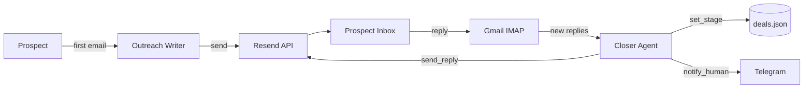

# AI Sales SDR Agent

An AI sales agent that writes cold email, reads replies, and follows up while a human confirms wins.

[](https://github.com/nse4real/ai-sales-sdr-agent/actions/workflows/test.yml)
[](LICENSE)
[](.github/workflows/test.yml)

<!-- DEMO: add docs/demo.gif here -->

## See it work

From a recorded test with Ada Lovelace at the fictional Lovelace Labs:

> **Prospect:**
> Sounds interesting. How does it handle evidence collection for SOC2?
>
> **Agent:**
> Great question. ComplAI helps centralize evidence requests, track owners and due dates, and use AI to organize/support evidence so your team spends less time chasing files.
> We also keep the process organized for audit prep and auditor follow-up.

[Read all three messages](examples/sample_conversation.md).

## How it works

The OpenAI Agents SDK runs an outreach writer and a closer. The writer creates a personalised first email. Every message carries a `[ref:<deal_id>]` subject tag so replies can be matched to a deal. The closer reads each reply and uses `send_reply`, `set_stage`, or `notify_human`. Resend sends email, Gmail IMAP receives replies, and Telegram alerts the owner about email, replies, opt-outs, and outcomes. All application code is in [sdr_agent.py](sdr_agent.py).



Edit `PRODUCT_PITCH` near the top of `sdr_agent.py` to change the product description used by both agents.

## Design decisions

- Fetch replies with `BODY.PEEK[]` and track handled Message-IDs. A plain RFC822 fetch marks mail read; the original notebook could silently lose a reply when handling failed. Opening mail in Gmail first does not hide it from this agent. A reply whose handling fails is retried next cycle (within the 14-day window).
- Bind the deal in the run context. The model cannot choose which deal its tools act on; it still writes email content.
- Keep `won` human-only. The agent can move a deal to `negotiating` or `lost`, and asks the owner to confirm a win.
- Check the six-touch limit, closed deals, and address-level opt-outs in code at the send boundary, so these checks do not depend on prompt instructions.
- Use at-least-once delivery, atomic saves, and a single JSON file for simplicity. Each update reloads the file, then saves through a temporary file and atomic replace. A crash after a successful send can cause a repeated send. See the limits below.

## Quick start

You need Python 3.10+, an OpenAI API key, a Resend account and API key, and Gmail with IMAP enabled and an app password. A Telegram bot token and chat ID are optional.

Install dependencies and create your local configuration:

```bash
python -m pip install -r requirements.txt
cp .env.example .env
```

Fill in `.env` using [.env.example](.env.example). Resend's default `onboarding@resend.dev` sender only delivers to the Resend account owner until a domain is verified, so keep `SEND_TO_SELF=true` for initial testing. This routes all outbound mail to `EMAIL_ADDRESS2`.

Optionally set BOOKING_LINK (an https URL such as a Calendly link); both agents are told to include it when they propose a call, and an invalid value is ignored with a warning.

Start a deal and send its first email:

```bash
python sdr_agent.py start --first-name Ada --company "Lovelace Labs" --role "Head of Compliance" --email ada@example.com
```

The command prints the new deal ID. Reply from the test recipient, then process the inbox once:

```bash
python sdr_agent.py check
```

## CLI reference

`start --first-name NAME --company COMPANY --role ROLE --email ADDRESS` creates a deal and sends the first email, as shown above. `check` processes the inbox once.

Poll every 60 seconds for 30 cycles:

```bash
python sdr_agent.py loop --interval 60 --cycles 30
```

List deals, or let a human confirm a win:

```bash
python sdr_agent.py deals
python sdr_agent.py won <deal_id>
```

`start`, `check`, and `loop` validate required environment variables before doing any work. Only the `won` CLI command can mark a deal `won`; the closer can set only `negotiating` or `lost`.

## What the tests protect

The suite is fully offline. Resend, Telegram, IMAP, and the agent runner are faked. [test_sdr_agent.py](test_sdr_agent.py) checks that:

- A reply whose handling fails is retried next cycle (within the 14-day window), without duplicate history. Other replies in the cycle still run, and the IMAP connection closes.
- Only mail from the prospect's address is processed, which is routing, not authentication. In self-test mode, replies from `EMAIL_ADDRESS2` are also accepted. An unrelated sender does not reach the closer.
- STOP never reaches the model or sends an email. It records an opt-out even on a closed deal and suppresses other deals for that address.
- Closed deals, opted-out addresses, and deals at the touch limit cannot send. An opted-out address cannot start a new deal.
- Only a human can set `won`. The closer's tools act on the deal bound in context and do not take a model-supplied deal ID.
- A Telegram HTTP outage does not break sending. A send failure propagates so handling can be retried, and successful tool writes survive the final handled-ID save.
- Self-test sends use the test recipient, keep one reference tag, and include the opt-out footer. A missing self-test recipient fails before HTTP.
- Reply fetches use `BODY.PEEK[]`, include read mail, and use string IDs. Missing Message-IDs fall back to IMAP UIDs. Different Message-IDs keep identical reply texts distinct.
- HTML fallback removes scripts and styles and decodes entities. IMAP dates use English month names regardless of the OS locale.
- Saves atomically replace the deal file, new IDs have a UUID suffix, and email addresses are normalized.
- Booking links are optional in both prompts. Invalid links are ignored with a warning that never echoes the value.
- Missing command configuration exits before work starts.

```bash
python -m pip install -r requirements-dev.txt
python -m pytest -q
python sdr_agent.py --help
```

CI runs tests and CLI help on Python 3.10 and 3.12 for pushes and pull requests without service secrets. A separate job scans full Git history with the standalone Gitleaks CLI. Its [pinned release](https://github.com/gitleaks/gitleaks/releases/tag/v8.30.1) is checked against the release checksums before use.

## Compliance

Every outbound email includes `Reply "stop" to opt out.` A first non-empty reply line containing `stop`, `unsubscribe`, `remove me`, `do not contact`, or `don't contact` marks the deal lost and sets `opted_out: true` without calling the model or sending email. This applies to STOP replies on won or lost deals too. Any deal with the same normalized prospect email is then blocked from sending, and `start_deal` refuses that address.

## Security

Only mail from the prospect's address is processed, which is routing, not authentication. In self-test mode, `EMAIL_ADDRESS2` is also accepted. Sender addresses can be spoofed. Reply text is untrusted and may try to steer the model. The human-only `won` gate and code-enforced closed-deal, opt-out, and touch-limit send boundaries are the controls; they do not make reply content trustworthy. The model cannot choose which deal its tools act on, but it still writes email content.

## Data & privacy

OpenAI Agents SDK tracing uploads run data to OpenAI by default. Set `OPENAI_AGENTS_DISABLE_TRACING=1` to disable tracing. The closer receives the whole deal JSON, including prospect details and history, as model input even with tracing disabled.

Reply excerpts are forwarded to Telegram when configured. Without Telegram, notifications print reply excerpts to stdout. `deals.json` contains prospect data and conversation history and is gitignored; protect and delete it according to your data-retention requirements.

## Trade-offs and production considerations

- `deals.json` is a single-process store with no locking. Concurrent processes can lose updates; a database with transactions would be safer.
- Polling Gmail is simple but delayed. No webhook server is included.
- Delivery is at-least-once. A reply whose handling fails is retried next cycle (within the 14-day window). Replies older than 14 days (`REPLY_WINDOW_DAYS`) are not fetched. There is no dead-letter queue for repeatedly failing messages.
- Handled messages are marked read for convenience. Message-IDs, rather than read flags, decide what has been handled.
- Routing uses only the subject tag, not `In-Reply-To` or `References`, so a removed or changed tag breaks matching.
- A dashboard, package layout, and PyPI distribution are intentionally out of scope to keep this a single-file tool.

## Roadmap

- An evaluation script for closer decisions.
- Inbound webhooks instead of polling.
- `In-Reply-To` matching.

## Contributing

See [CONTRIBUTING.md](CONTRIBUTING.md) for setup, offline tests, and contribution rules.

## Security reports

Follow [SECURITY.md](SECURITY.md) to report a vulnerability privately.

## Author

Nsenam Udoh — [LinkedIn](https://www.linkedin.com/in/senamudoh/) · [X](https://x.com/sehizie).

## License

[MIT](LICENSE).
