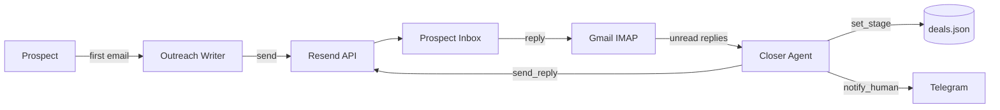

# AI Sales SDR Agent

An AI sales agent that writes and sends cold email, reads prospect replies, and keeps the conversation going until a deal is won or lost. It uses the OpenAI Agents SDK, Resend, Gmail IMAP, and Telegram, with all application code in `sdr_agent.py`.

## How it works

The outreach writer creates a personalised first email. Every message carries a `[ref:<deal_id>]` subject tag so replies can be matched to a deal. The closer agent reads each reply and chooses one tool: `send_reply`, `set_stage`, or `notify_human`. Telegram alerts the owner about email, replies, opt-outs, and outcomes.



Guardrails include six touches per deal, closed-deal and opt-out send blocks, Message-ID deduplication, sender routing checks, and a human-only `won` transition. `SEND_TO_SELF=true` routes outbound mail to `EMAIL_ADDRESS2` during testing. Edit `PRODUCT_PITCH` near the top of `sdr_agent.py` to change the product description used by both agents.

## Setup

Prerequisites:

- Python 3.10+
- An OpenAI API key
- A Resend account and API key
- Gmail with IMAP enabled and an app password
- Optionally, a Telegram bot token and chat ID

Install dependencies and create your local configuration:

```bash
python -m pip install -r requirements.txt
cp .env.example .env
```

Fill in `.env`. Resend's default `onboarding@resend.dev` sender only delivers to the Resend account owner until a domain is verified, so keep `SEND_TO_SELF=true` for initial testing.

## CLI

Start a deal and send its first email:

```bash
python sdr_agent.py start --first-name Ada --company "Lovelace Labs" --role "Head of Compliance" --email ada@example.com
```

The command prints the new deal ID. Reply from the test recipient, then process the inbox once:

```bash
python sdr_agent.py check
```

Poll every 60 seconds for 30 cycles:

```bash
python sdr_agent.py loop --interval 60 --cycles 30
```

List deals, or let a human confirm a win:

```bash
python sdr_agent.py deals
python sdr_agent.py won <deal_id>
```

`start`, `check`, and `loop` validate their required environment variables before doing any work. Only the `won` CLI command can mark a deal `won`; the closer can set only `negotiating` or `lost`.

## Reply handling

`run_cycle()` fetches unread tagged messages with `BODY.PEEK[]`, which does not implicitly mark them read. A message is marked read only after it is handled. A closer failure leaves it unread for the next cycle, while other replies in the current cycle still run. Message IDs prevent duplicate history entries on retry, and identical replies with different Message-IDs are handled independently.

Each state update reloads `deals.json` before changing fields. Saves use a temporary file followed by an atomic replace. Delivery is **at-least-once**: a crash immediately after a successful send can cause that send to be repeated on retry.

## Testing

The suite is fully offline: Resend, Telegram, IMAP, and the agent runner are faked.

```bash
python -m pip install -r requirements-dev.txt
python -m pytest -q
python sdr_agent.py --help
```

CI runs the same tests on Python 3.12 for pushes and pull requests without secrets.

## Compliance

Every outbound email includes `Reply "stop" to opt out.` A first non-empty reply line containing `stop`, `unsubscribe`, `remove me`, `do not contact`, or `don't contact` marks the deal lost and sets `opted_out: true` without calling the model or sending email. Closed or opted-out deals cannot send, and `start_deal` refuses an address that has previously opted out.

## Security

The sender check is routing, **not authentication**: sender addresses can be spoofed. Reply text is untrusted and may try to steer the model. The human-only `won` gate and code-enforced closed-deal, opt-out, and touch-limit send boundaries are the controls; they do not make reply content trustworthy.

## Data & privacy

OpenAI Agents SDK tracing uploads run data to OpenAI by default. Set `OPENAI_AGENTS_DISABLE_TRACING=1` to disable tracing. Reply text is forwarded to Telegram when Telegram is configured. `deals.json` contains prospect data and conversation history and is gitignored; protect and delete it according to your data-retention requirements.

## Trade-offs and production considerations

- `deals.json` is a single-process store with no locking. Concurrent processes can lose updates; a database with transactions would be safer.
- Polling Gmail is simple but delayed. Inbound webhooks would provide faster replies; no webhook server is included.
- Delivery is at-least-once, and failed replies remain unread. There is no dead-letter queue for repeatedly failing messages.
- Routing uses only the subject tag, not `In-Reply-To` or `References`, so a removed or changed tag breaks matching.
- A dashboard, package layout, and PyPI distribution are intentionally out of scope to keep this a single-file tool.
