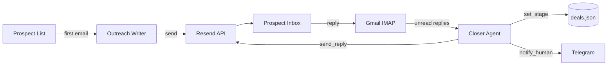

# AI Sales SDR Agent

AI sales agent that writes and sends cold emails, reads prospect replies, and keeps the conversation going until a deal is won or lost. Built with the OpenAI Agents SDK, the Resend API, Gmail IMAP and Telegram.

## Overview

The agent sends a personalised first email to each prospect through Resend. Every email carries a `[ref:<deal_id>]` tag, so when the prospect replies, the reply is matched to its deal. A closer agent reads the reply, decides the next step, answers it, and updates the deal stage. Telegram sends an alert for every email, reply and deal outcome, so you can follow each deal from your phone.

Guardrails: a touch limit per deal and `SEND_TO_SELF`, which routes all mail to your own address while you test.

## Architecture


**Components:**
- **Outreach Writer:** LLM agent that writes the first cold email (structured output: subject, text, HTML)
- **Closer Agent:** LLM agent with three tools: `send_reply`, `set_stage`, `notify_human`. It picks one next step per reply
- **Sending:** Resend REST API. Replies go to your Gmail via `Reply-To`
- **Reply Intake:** Gmail IMAP, filtered to unread messages with a `[ref:...]` subject tag
- **Deal Store:** `deals.json` (stage, touch count, full message history per deal)
- **Alerts:** Telegram bot

## Setup Instructions

### Prerequisites

- **Python** (3.10+)
- **OpenAI API key**
- **Resend account** and API key
- **Gmail account** with IMAP enabled and an app password
- **Telegram bot** token and your chat ID
- Python dependencies:
```bash
  pip install openai-agents python-dotenv pydantic requests
```

### Quick Start

1. Copy the environment template and fill in your keys:
```bash
   cp .env.example .env
```

2. Open `ai_sales_sdr_agent.ipynb` and run the setup cells.

3. Send the first email to a prospect:
```python
   deal_id = await start_deal({"first_name": "Ada", "company": "Lovelace Labs", "role": "Head of Compliance", "email": "ada@example.com"})
```

4. Reply to the email from your test address, then check the inbox:
```python
   await run_cycle()
```

5. Or keep checking every 60 seconds:
```python
   await run_loop(interval_s=60, cycles=60)
```

**Note:** Resend's default sender `onboarding@resend.dev` only delivers to the Resend account owner until a domain is verified. Keep `SEND_TO_SELF = True` for testing.

## Data Flow

A prospect's first email is written by the outreach agent and sent through Resend, and a new deal is stored with stage `outreach`. When the prospect replies, `run_cycle()` fetches unread Gmail messages whose subject carries a `[ref:...]` tag and skips the agent's own copies. The matching deal's history is updated and the closer agent gets the deal and the reply. The closer answers through `send_reply`, moves the deal with `set_stage`, or escalates with `notify_human`. Each message is marked read only after it is handled, and a reply whose text is already in the history is skipped, so a retry cannot answer twice.

## Trade-offs & Production Considerations

Replies are read by polling Gmail over IMAP, which is simple and needs no public server. Production would use inbound webhooks (for example Resend's inbound email) so replies arrive instantly and nothing polls.

The closer agent acts on prospect text it has not verified. A reply can ask for a stage change or a message, so the agent can be steered by the reply content. Production should keep a human approval step before a deal is marked `won` and before any pricing or contract message is sent.

`deals.json` is a single local file with no locking. Two processes writing at once can lose updates. Production would use a database with per-deal transactions.

## Future Improvements

* The agent has no human approval gate before `won`, so a deal can close from the reply text alone.
* There is no automated test suite. Reply matching, the duplicate guard and touch limits are only checked by hand.
* Replies are polled every 60 seconds. Webhooks would remove the polling delay and load.
* Deal state lives in a JSON file. A database would make the store safe to share between processes.
